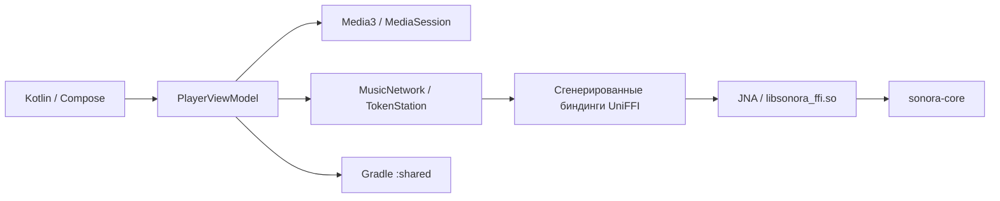

# Sonora для Android

Sonora — нативный музыкальный плеер для Android 8.0+ на ARM64. Готовые APK находятся в [Releases](https://github.com/MixiYT/SonoraAndroidNative/releases).

## Сборка из исходников

Используйте [общий репозиторий исходников](https://github.com/MixiYT/Sonora-development-share). Текущий снимок Android — 0.3.26. Сохраняйте рядом `sonora-android/` и `crates/`, поскольку скрипт использует относительный путь к UniFFI.

Соберите APK через `./build-native.ps1` из `sonora-android`. Понадобятся JDK 21, JVM toolchain 17, SDK API 37, NDK 27.2.12479018, Rust и цель `aarch64-linux-android`. См. [полную инструкцию](https://github.com/MixiYT/Sonora-development-share#сборка-android).

## Зависимости

См. [подробную карту](https://github.com/MixiYT/Sonora-development-share/blob/main/DEPENDENCY-MAP.md), [файловый индекс](https://github.com/MixiYT/Sonora-development-share/blob/main/docs/dependency-index.md) и [историю изменений](https://github.com/MixiYT/Sonora-development-share/blob/main/CHANGELOG.md).
